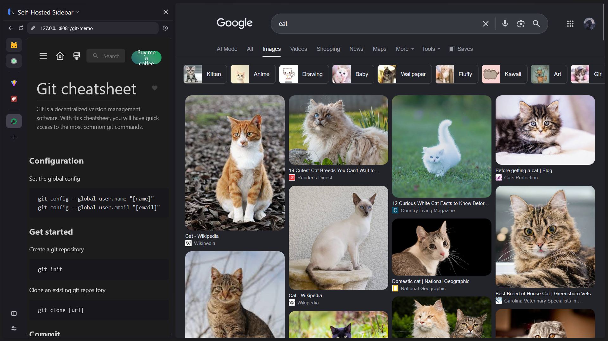
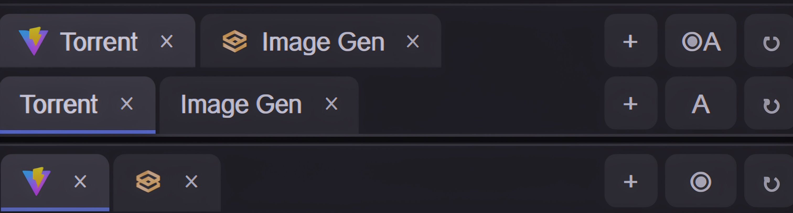
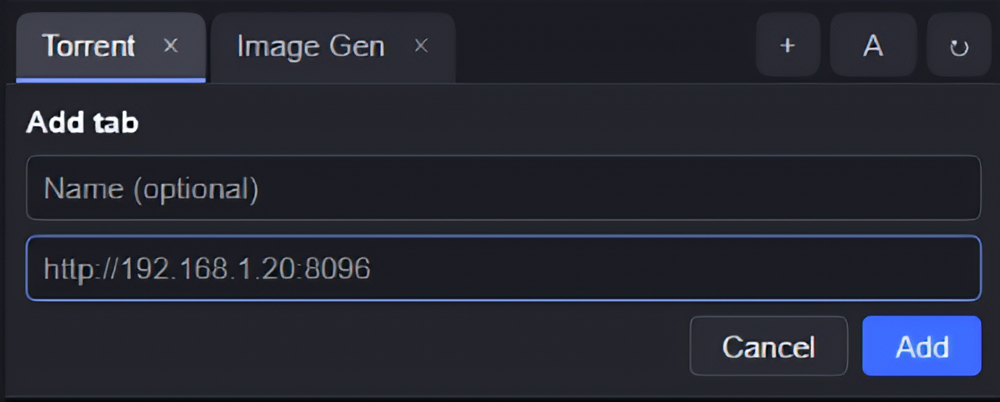
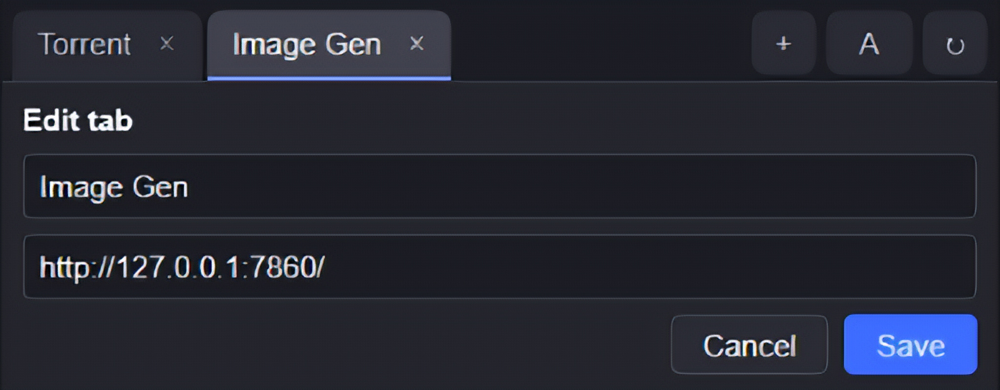

<div align="center">


# Self-Hosted Sidebar

**Dock your self-hosted apps, Docker services and local dev servers in Firefox's sidebar as named tabs.**

[](https://addons.mozilla.org/en-US/firefox/addon/self-hosted-sidebar/)


</div>

<p align="center">
  
</p>

---

## What it does

Self-Hosted Sidebar keeps the web apps you run yourself one keystroke away while you browse. Add an address, give it a name, and it lives in the Firefox sidebar as a tab.

Great for:

- Dashboards (Homepage, Heimdall, Grafana)
- Media servers (Jellyfin, Plex, Navidrome)
- Home automation panels (Home Assistant)
- Dev servers (Vite, Next.js) and docs sites running in Docker
- Anything you can reach at a local or LAN address

> This add-on is built for apps you host yourself. Large public websites usually refuse to load inside a sidebar, so they are not supported.

## Screenshots

| Tabs and display modes                     | Adding a tab                                  | Edit existing tab                              |
| ------------------------------------------ | --------------------------------------------- | ---------------------------------------------- |
|  |  |  |

## Features

- **Named tabs.** Give each app a name, or leave it blank to show the port.
- **Tabs stay loaded.** Switching keeps each app's state, scroll position and connections.
- **Works with any address you host.** `localhost`, `127.0.0.1`, LAN IPs, `.local` names or your own domain, over http or https.
- **Three display modes.** Icon and name, icon only, or name only.
- **Easy editing.** Double-click or right-click a tab to edit it. Close it with the x or a middle-click.
- **Dark tab bar** that suits the Firefox sidebar.
- **Keyboard shortcut.** `Alt+Shift+T` toggles the sidebar.

## Install

[](https://addons.mozilla.org/en-US/firefox/addon/self-hosted-sidebar/)

## Usage

1. Open the sidebar with `Alt+Shift+T`.
2. Click **+**, enter the address of your app (for example `localhost:8080`) and an optional name.
3. Approve the access prompt the first time you add a host. Access is granted one host at a time and can be revoked later in the add-on's permissions.

To change the shortcut, open `about:addons`, click the gear icon and choose **Manage Extension Shortcuts**.

## Permissions

| Permission                                 | Why                                                                                                                                                                                                 |
| ------------------------------------------ | --------------------------------------------------------------------------------------------------------------------------------------------------------------------------------------------------- |
| `storage`                                  | Saves your tab names and URLs locally.                                                                                                                                                              |
| `http://localhost/*`, `http://127.0.0.1/*` | Default hosts, so local dev servers work without a prompt.                                                                                                                                          |
| Optional `http://*/*`, `https://*/*`       | Requested one host at a time, only when you add or edit a tab.                                                                                                                                      |
| `webRequest`, `webRequestBlocking`         | Removes `X-Frame-Options` and the CSP `frame-ancestors` directive on responses from hosts you granted, only for pages shown inside this extension's sidebar, so those pages can load in the iframe. |

Only grant access to hosts you trust.

## Privacy

The extension collects no data and sends nothing to the developer or any third party. It only contacts the addresses you add, to load the page and find its icon. Your tab list is stored locally with `storage.local`.

## Known limits

- Many sites forbid being embedded. Large public sites and single sign-on pages will likely refuse to load.
- For an https app with a self-signed certificate, open it once in a normal tab and accept the certificate.
- Firefox unloads sidebar content when the sidebar is closed or switched to another panel (such as History), so apps reload the next time you open it.

## Development

There is no build step.

1. Check the extension

   ```bash
   npx web-ext lint
   ```

2. Launch in a temporary Firefox profile

   ```bash
   npx web-ext run
   ```

3. Create the zip

   ```bash
   npx web-ext build
   ```

Issues and pull requests are welcome. Please ensure you fork the repository and submit all Pull Requests to the `dev` branch, as this project follows a `dev` -> `main` workflow.

## License

[MIT](LICENSE)

---

<sub>Not affiliated with any of the projects you may choose to embed.</sub>
